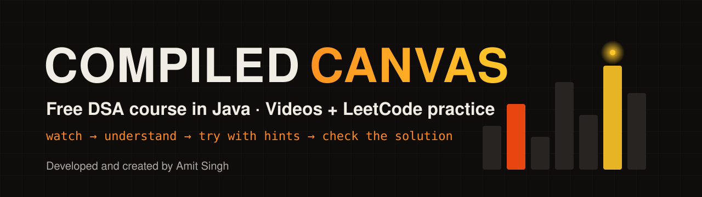

  

<b>Developed and created by Amit Singh</b>

  
  
  
  
  

[🏠 All Compiled Canvas courses](../README.md)

# Free DSA course in Java — videos + 352 LeetCode problems

Watch each Compiled Canvas episode, then solve its LeetCode list right here. Every problem has a short summary, an **Understanding** section with a worked example, hints you open one at a time, the approach, a commented **Java** solution, complexity and the most common mistake — so you never need another site.

🟢 112 Easy · 🟡 192 Medium · 🔴 48 Hard

🌐 **Interactive course page (progress tracking, filters, hints):** https://amitxaidev.github.io/  
▶️ **Watch the full DSA series in order:** https://www.youtube.com/playlist?list=PLUDfZ2cL52Lg

📺 **New here? Start with [Ep 1 · DSA Roadmap 2026](https://youtu.be/z7LRqT8mBQ4).**

## How to use this course

1. **Watch** the episode for a topic (thumbnail in the syllabus below).
2. **Understand** — read the topic intro, then each problem's Understanding section.
3. **Try** the problem on LeetCode. Stuck for 15+ minutes? Open **one** hint at a time.
4. **Check** the approach and the Java solution, and read the common mistake.
5. **Track** your progress on the website, or fork this repo and tick the boxes.

## Syllabus

| Video | Topic | Problems | Practice |
|---|---|:-:|---|
|  | **1. Time & Space Complexity** Warm-up problems where the point is to say the Big O of your own code before you submit it. Eps 2–3 · [▶ Ep 2](https://youtu.be/jZeS1tRzGs4) · [▶ Ep 3](https://youtu.be/PxjhjjhEIqw) | **6** | [Solve the problems →](./01-complexity)  [on the website](https://amitxaidev.github.io/dsa/01-complexity/) |
|  | **2. Java Basics for DSA** Arrays, Strings, StringBuilder and Collections — the Java toolbox every later topic uses. Ep 4 · [▶ Ep 4](https://youtu.be/YvtYDDQgn9U) | **10** | [Solve the problems →](./02-java-basics)  [on the website](https://amitxaidev.github.io/dsa/02-java-basics/) |
|  | **3. Basic Math** Primes, GCD, modulo, digits and the Sieve of Eratosthenes. Ep 5 · [▶ Ep 5](https://youtu.be/y1GZw3VByAU) | **13** | [Solve the problems →](./03-math)  [on the website](https://amitxaidev.github.io/dsa/03-math/) |
|  | **4. Bit Manipulation** AND, OR, XOR, shifts and the classic bit tricks. Ep 6 · [▶ Ep 6](https://youtu.be/ZzdK8SqvsGU) | **12** | [Solve the problems →](./04-bit-manipulation)  [on the website](https://amitxaidev.github.io/dsa/04-bit-manipulation/) |
|  | **5. Arrays** Traversal, in-place updates, rotation and the top array interview questions. Eps 7–15 · [▶ Ep 7](https://youtu.be/4NdluWqUZ3c) | **14** | [Solve the problems →](./05-arrays)  [on the website](https://amitxaidev.github.io/dsa/05-arrays/) |
|  | **6. Prefix Sum** Precompute running totals so range questions become O(1). Ep 8 · [▶ Ep 8](https://youtu.be/liU6avyvXQM) | **12** | [Solve the problems →](./06-prefix-sum)  [on the website](https://amitxaidev.github.io/dsa/06-prefix-sum/) |
|  | **7. Two Pointers** Opposite ends, same direction, and merging — two indexes instead of nested loops. Ep 9 · Coming soon | **13** | [Solve the problems →](./07-two-pointers)  [on the website](https://amitxaidev.github.io/dsa/07-two-pointers/) |
|  | **8. Sliding Window** Fixed and variable windows over arrays and strings. Ep 10 · Coming soon | **14** | [Solve the problems →](./08-sliding-window)  [on the website](https://amitxaidev.github.io/dsa/08-sliding-window/) |
|  | **9. Kadane, Dutch Flag & Moore's Voting** Three famous one-pass array algorithms and their variations. Eps 11–13 · Coming soon | **9** | [Solve the problems →](./09-kadane-dnf-moore)  [on the website](https://amitxaidev.github.io/dsa/09-kadane-dnf-moore/) |
|  | **10. 2D Arrays & Matrix** Rotate, spiral, search and in-place tricks on grids. Ep 14 · Coming soon | **10** | [Solve the problems →](./10-matrix)  [on the website](https://amitxaidev.github.io/dsa/10-matrix/) |
|  | **11. Strings** StringBuilder, palindromes, anagrams, frequency counting and top string questions. Eps 16–20 · Coming soon | **15** | [Solve the problems →](./11-strings)  [on the website](https://amitxaidev.github.io/dsa/11-strings/) |
|  | **12. String Pattern Matching** KMP, Rabin-Karp and the Z-algorithm. Eps 18–19 · Coming soon | **7** | [Solve the problems →](./12-string-matching)  [on the website](https://amitxaidev.github.io/dsa/12-string-matching/) |
|  | **13. Binary Search** Lower/upper bound, rotated arrays and binary search on the answer. Eps 21–23 · Coming soon | **17** | [Solve the problems →](./13-binary-search)  [on the website](https://amitxaidev.github.io/dsa/13-binary-search/) |
|  | **14. Sorting** Merge sort, quick sort, counting/bucket sort and custom comparators. Eps 24–28 · Coming soon | **11** | [Solve the problems →](./14-sorting)  [on the website](https://amitxaidev.github.io/dsa/14-sorting/) |
|  | **15. Recursion & Backtracking** Subsets, permutations, combinations, N-Queens, Sudoku and word search. Eps 29–36 · Coming soon | **18** | [Solve the problems →](./15-recursion-backtracking)  [on the website](https://amitxaidev.github.io/dsa/15-recursion-backtracking/) |
|  | **16. Hashing** HashMap and HashSet patterns: counting, grouping and prefix-sum maps. Eps 37–39 · Coming soon | **12** | [Solve the problems →](./16-hashing)  [on the website](https://amitxaidev.github.io/dsa/16-hashing/) |
|  | **17. Linked List** Reverse, fast & slow pointers, merge, and LRU cache. Eps 40–45 · Coming soon | **19** | [Solve the problems →](./17-linked-list)  [on the website](https://amitxaidev.github.io/dsa/17-linked-list/) |
|  | **18. Stack & Queue** Parentheses, expression evaluation, monotonic stack and deque. Eps 46–52 · Coming soon | **18** | [Solve the problems →](./18-stack-queue)  [on the website](https://amitxaidev.github.io/dsa/18-stack-queue/) |
|  | **19. Binary Trees** Traversals, BFS, height/diameter, views, LCA, construction and serialization. Eps 53–60 · Coming soon | **20** | [Solve the problems →](./19-binary-trees)  [on the website](https://amitxaidev.github.io/dsa/19-binary-trees/) |
|  | **20. Binary Search Trees** Insert, delete, validate, kth smallest and BST iterators. Eps 61–63 · Coming soon | **12** | [Solve the problems →](./20-bst)  [on the website](https://amitxaidev.github.io/dsa/20-bst/) |
|  | **21. Heaps & Priority Queue** Top K, k-way merge and the two-heap median pattern. Eps 64–68 · Coming soon | **13** | [Solve the problems →](./21-heaps)  [on the website](https://amitxaidev.github.io/dsa/21-heaps/) |
|  | **22. Greedy** Intervals, jump game, gas station and exchange arguments. Eps 69–73 · Coming soon | **14** | [Solve the problems →](./22-greedy)  [on the website](https://amitxaidev.github.io/dsa/22-greedy/) |
|  | **23. Graphs** BFS/DFS, islands, cycles, topo sort, bipartite, shortest paths, MST, DSU, SCC and bridges. Eps 74–85 · Coming soon | **21** | [Solve the problems →](./23-graphs)  [on the website](https://amitxaidev.github.io/dsa/23-graphs/) |
|  | **24. Dynamic Programming** 1D, grid, knapsack, subsequences, strings, stocks, partition, trees and bitmask DP. Eps 86–96 · Coming soon | **28** | [Solve the problems →](./24-dynamic-programming)  [on the website](https://amitxaidev.github.io/dsa/24-dynamic-programming/) |
|  | **25. Trie** Prefix trees for words, autocomplete and XOR tricks. Ep 97 · Coming soon | **8** | [Solve the problems →](./25-trie)  [on the website](https://amitxaidev.github.io/dsa/25-trie/) |
|  | **26. Segment Tree, Fenwick & Sparse Table** Range queries with point updates. Eps 98–100 · Coming soon | **6** | [Solve the problems →](./26-segment-fenwick)  [on the website](https://amitxaidev.github.io/dsa/26-segment-fenwick/) |
| | **Total** | **352** | |

Episodes 101–105 (patterns, mock interviews and common mistakes) use the whole sheet as practice.

## More courses are coming

DSA in Java is live. Next on the plan: Java, AI for Developers, Python, SQL, Spring Boot, OOPS, System Design, and Interviews, Resume & LinkedIn. [Subscribe on YouTube](https://www.youtube.com/@compiledcanvas?sub_confirmation=1) so you don't miss them.

## Notes

- Problem statements belong to LeetCode; we only link to them and summarise in our own words. All solutions are original.
- Found a bug or a cleaner solution? Open an issue or a pull request.
- Solutions and notes are released under the [MIT License](../LICENSE).

---

Developed and created by **Amit Singh** · **Compiled Canvas** · [YouTube @compiledcanvas](https://www.youtube.com/@compiledcanvas) · [Instagram @compiledcanvas](https://www.instagram.com/compiledcanvas)  
▶️ Watch the full DSA series in order: https://www.youtube.com/playlist?list=PLUDfZ2cL52Lg
